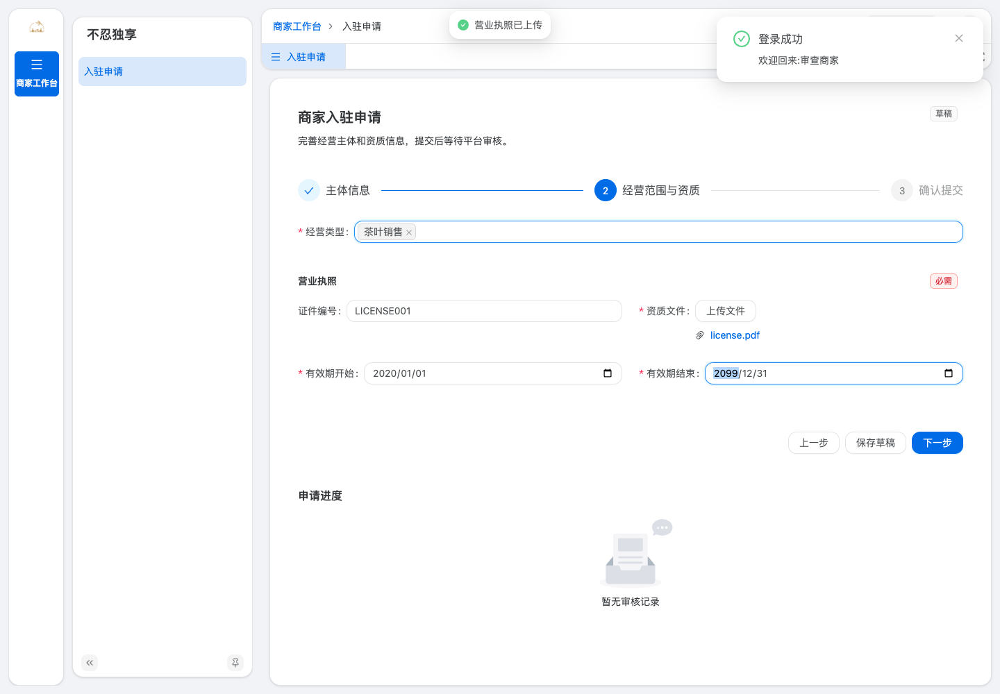
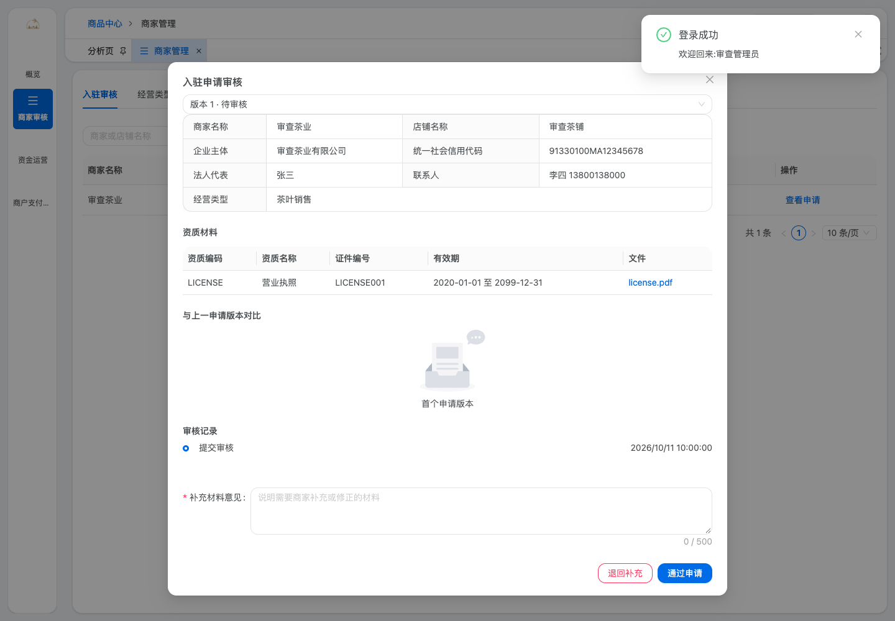
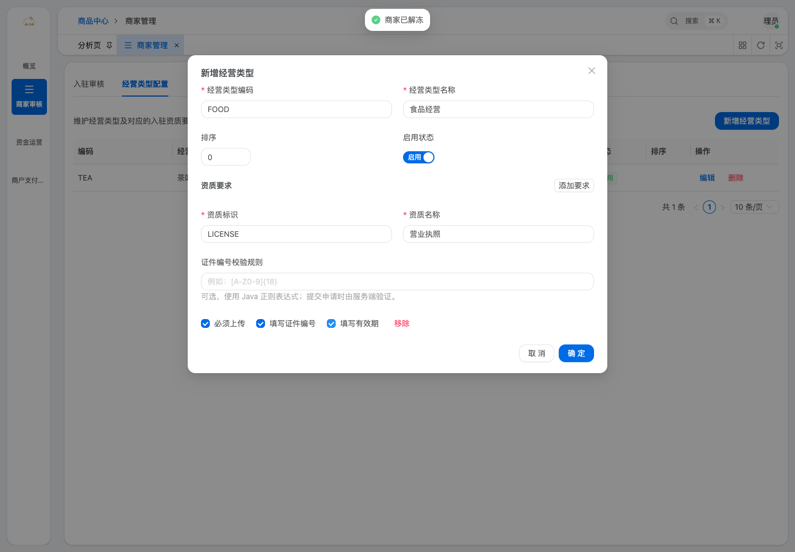

# 商家自助入驻与审核实施复核

复核日期：2026-10-11。目标分支：后端和 `yudao-ui-admin-vben` 均为 `teaworthshare`。

## 业务结果

商家在管理端注册独立账号，填写主体资料，选择经营类型并提交资质，同意平台配置的协议后提交审核。平台执行单级审核；驳回后商家补正并提交新的申请版本，通过后开放商家商品、品牌、订单和售后操作。

商家与会员、管理员身份分离。商家仅访问 `/merchant-api`，不能使用商家令牌访问 `/admin-api`；管理员令牌也不能充当商家身份。商家编号由服务端身份与账号绑定关系确定，客户端提交的商家编号不能作为授权依据。

仅 `APPROVED` 商家可以经营。冻结、主体变更待审和主体变更驳回均暂停商品与履约操作，商城查询、营销列表和结算也过滤相关商品。店铺展示信息可以直接更新；主体、法人、信用代码、经营类型及关键资质变更通过申请版本重新审核。暂停和恢复使用商家状态门禁，不批量覆写原商品上下架状态。

本次保留既有支付与商家订单模型，没有新增支付流程、分账、提现或结算账户。

## 计划逐项复核

| 任务 | 实现与复核证据 |
| --- | --- |
| Task 1：独立商家身份 | `UserTypeEnum.MERCHANT=3`、`system_merchant_user`、注册/登录/刷新/登出/档案接口、令牌中的商家编号、登录日志、管理员账号查询/禁用/密码重置。由 `MerchantAuthServiceImplTest`、`MerchantUserServiceImplTest`、`OAuth2TokenServiceImplTest` 覆盖。 |
| Task 2：商家 API 安全 | Web 自动前缀与用户类型识别、令牌身份校验、system/product/trade/infra 网关路由、服务端账号绑定与可经营状态验证。由 Web 身份测试、两个模块的 `MerchantSecurityServiceTest` 和控制器测试覆盖。 |
| Task 3：申请与审核领域 | 草稿、不可修改的已提交版本、申请资质快照、协议版本/同意时间/IP、单级通过/驳回、追加式审核记录、展示资料更新与关键变更、历史账号关联与补正。删除普通管理员直接创建商家及直接修改生效资质的入口。由 `ProductMerchantApplicationServiceImplTest` 覆盖。 |
| Task 4：管理端与商家流程 | 平台申请列表、详情、证件临时预览、版本对比、审核历史、冻结/解冻、经营类型和资质要求配置、账号管理；商家注册、申请向导、动态资质、草稿、同意协议、补正、时间线、受限工作台。只改动 `apps/web-antd`。 |
| Task 5：商品与交易授权 | 商品、品牌仅操作当前商家数据；品牌与商品归属及经营状态校验；订单、发货、售后校验商家归属。保留平台管理员全局管理。由商家商品控制器、订单控制器、售后 Mapper 隔离测试及现有交易测试覆盖。 |
| Task 6：迁移与兼容 | 更新 MySQL 初始化、历史迁移、system 独立迁移与测试表结构；保留历史商家/商品/品牌/订单；不生成历史登录账号；历史申请使用 `LEGACY`，不伪造协议同意。MySQL 8.4 初始化与重复迁移实跑通过。 |

## Review 中修复的问题

- 账号绑定 RPC 在本地事务提交后执行，失败时可重试绑定同一商家，避免留下指向已回滚商家的账号。
- 申请提交和审批均校验必交资质、编号规则、有效期、文件存在性与归属；审核等待期间过期的证件不能直接通过。选择多个经营类型时取资质要求并集并保留规则快照。
- 敏感主体和证件字段继续加密；历史明文仅通过显式迁移开关处理。历史公开链接不直接用于申请预览；仅唯一匹配的私有文件可以关联，无法授权的文件需要重新上传。
- 历史商家关联已注册账号时保留历史申请的提交人快照；未完成审核的历史商家必须补齐材料、确认协议、重新提交。
- 商城、收藏、浏览历史、分组、营销分页和结算统一应用经营门禁；营销过滤在 SQL 分页前执行，避免总数与可见条数不一致。
- 前端会话版本隔离登录、登出、刷新和 401 响应，旧会话不能覆盖新身份或重放旧写请求；切换身份和审核状态时清理旧动态路由。
- 商家菜单生成强制使用商家菜单数据，排除管理员静态菜单；清理管理员固定标签和经营权限已失效的商家标签。
- 在实际生产构建页面发现未注册 Ant Design 组件，改为显式导入，并修复组件属性和事件类型。
- 平台商家下拉选项加载全部分页，超过 200 家时仍可选择。

## 验证结果

| 验证 | 结果 |
| --- | --- |
| 受影响后端模块及依赖的 Maven 测试 | 1176 项，0 失败、0 错误、18 项跳过；`BUILD SUCCESS`。 |
| 聚合 `yudao-server` 打包 | 42 个 reactor 项目成功。 |
| 前端完整 Vitest（4 workers） | 168 个文件、964 项通过。 |
| `web-antd` 类型检查 | 通过。 |
| 本次前端文件 ESLint / Vue Stylelint | 均通过。 |
| `web-antd` 生产构建 | 11 个任务成功。 |
| Chrome 生产构建冒烟（mock API） | 商家注册、动态资质上传、协议确认、提交、补正、通过后商品列表与新建弹窗、变更待审/冻结菜单门禁、管理员路由隔离；平台驳回/通过/冻结/解冻、经营类型及必交资质配置均通过，未出现页面脚本错误。 |
| MySQL 8.4 全量初始化 | `sql/mysql/ruoyi-vue-pro.sql`、`db/yudao.sql` 分别初始化通过。 |
| MySQL 8.4 历史迁移和重复执行 | 历史状态、长密文、无账号/无伪造协议、私有文件唯一匹配、品牌/商品/订单金额查询及幂等断言通过。 |

复验命令：

```sh
# Java 17，项目根目录
mvn -pl yudao-module-system/yudao-module-system-server,yudao-module-infra/yudao-module-infra-server,yudao-module-mall/yudao-module-product-server,yudao-module-mall/yudao-module-promotion-server,yudao-module-mall/yudao-module-trade-server -am test
mvn -pl yudao-server -am package -DskipTests

# yudao-ui-admin-vben，Node 24 / pnpm
pnpm exec vitest run --maxWorkers=4
pnpm -F @vben/web-antd typecheck
pnpm build:antd
```

## API 示例

```http
POST /merchant-api/system/auth/login
Content-Type: application/json

{"username":"merchant-account","password":"<账号密码>"}
```

登录返回独立商家 `accessToken`、`refreshToken` 和账号绑定的 `merchantId`；首次尚未填写申请时商家编号可以为空，工作台仍允许创建申请草稿。

```http
POST /merchant-api/product/merchant/application/submit
Authorization: Bearer <商家令牌>
Content-Type: application/json

{"accepted":true,"agreementVersion":"<当前商家协议版本>","privacyPolicyVersion":"<当前隐私政策版本>"}
```

服务器从登录账号定位当前草稿，验证资质及协议版本，记录服务端请求 IP 后进入待审状态。管理员对指定申请版本审批，不能直接跳过完整申请创建一个可经营商家。

## 部署顺序与配置

1. 备份数据库，在目标环境预演增量迁移。system 数据库执行 `sql/mysql/system_merchant_user.sql`；product/trade 使用现有部署共库布局执行 `sql/mysql/multi_merchant.sql`。生产已有库不要执行全量初始化或 dump 脚本。
2. 安全注入 `mybatis-plus.encryptor.password` 并保持与现有密文一致；不要直接更换历史数据使用的密钥。仅确认历史数据明确标记为明文时，临时启用 `yudao.product.merchant.encryption.allow-marked-plaintext` 和 `yudao.product.merchant.encryption.backfill-enabled`，完成回填后关闭。
3. 配置可用的私有对象存储用于资质，禁止资质长期公开访问；预览使用有效期 900 秒的授权地址。验证部署环境的上传、签名与权限策略。
4. 配置 `MERCHANT_AGREEMENT_VERSION`、`MERCHANT_AGREEMENT_URL`、`MERCHANT_PRIVACY_POLICY_VERSION`、`MERCHANT_PRIVACY_POLICY_URL`。链接要求 HTTPS 或当前站点相对地址，发布正式文件并确保商家可阅读。缺少有效配置时系统拒绝提交，避免记录无效同意。
5. 部署 system、infra、product、trade 与 gateway，以及本次 `web-antd` 构建。同步平台菜单和角色权限。历史商家继续由平台管理，不自动生成账号；需要自助管理时关联已注册且未绑定的商家账号。
6. 在正式环境执行商家注册、申请、审核、资质授权预览、商品与订单隔离联调。具体证件清单、协议内容和留存期限由平台配置并经法务确认。

## 验证边界

本地浏览器使用生产前端构建和 mock API 验证交互、路由、请求路径与状态展示；后端通过服务、控制器、H2/Mockito 测试及 MySQL 脚本实跑验证。未在本轮启动真实网关、所有微服务与私有对象存储进行完整端到端联调。该项应在目标部署环境完成；本地通过不代表对生产环境作出零缺陷保证。

仓库中的既有用户改动与本次无关草稿保留，不计入商家入驻提交。
前端按仓库约定手动完成上述检查后使用 `git commit --no-verify`，不重复运行提交钩子中的全工作区检查。

## 界面验证截图

以下为 mock API 测试数据，不包含真实商家资料。






